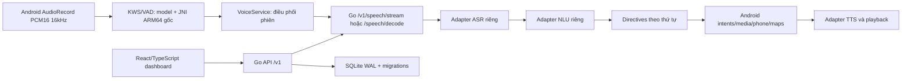

# Kiến trúc và ranh giới kiểm chứng

Android giữ settings/cache local bằng SharedPreferences/SQLiteOpenHelper để hỗ trợ Android 21. Server là nguồn quyền sử dụng, tài khoản, liên kết, giao dịch và phát hành. Các provider dùng tham chiếu biến môi trường; credentials nằm ngoài source và ZIP. Payload directive giữ dữ liệu gốc để adapter có thể đối chiếu với classifier/smali.

Thanh toán dùng SQLite transaction và khóa idempotency trên event/order/source cấp quyền. Sao lưu/khôi phục là lệnh của backend; không phụ thuộc Docker. Dashboard được build thành static và phục vụ cùng origin, token trình duyệt chỉ giữ trong bộ nhớ.

Native/model bytes được xác minh bằng SHA-256 riêng. Điều đó chứng minh tài nguyên không thay đổi, chưa chứng minh mọi luồng sử dụng mới tương đương thuật toán/lifecycle gốc. Kiểm thử JNI, audio session và giao diện có bằng chứng riêng trong `reports`.

Phần cứng camera/điều hòa/Bluetooth/nút vô lăng có ranh giới adapter và mô phỏng được ghi rõ. Intent maps/media/call phụ thuộc ứng dụng và quyền có trên thiết bị. LDPlayer không thay thế nghiệm thu trên đầu xe thật. Kết nối provider chỉ được nghiệm thu khi tài khoản/API riêng thực sự chấp nhận ứng dụng/certificate mới.
