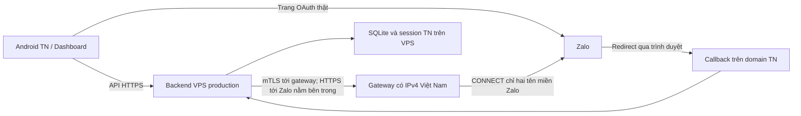

# Phương án gateway Zalo tại Việt Nam cho TN Assistant

Ngày lập: 29/10/2026; cập nhật 09/11/2026. Trạng thái: **transport mTLS đã vào backend production API184 nhưng vẫn ở chế độ direct; gateway Go đã build cục bộ và chưa triển khai vì chưa có host Việt Nam hoặc chứng thư**. Backend production chạy tại `/srv/tn-assistant`; webroot aaPanel là `/www/wwwroot/tn.assistant`.

## Căn cứ và lựa chọn

Release production hiện là API184 và APK `.189`. Trong lần quét QR thật gần nhất, callback và đổi mã đã tới backend, nhưng truy vấn hồ sơ nhận lỗi upstream `-501`, không có ID người dùng và không cấp session TN. Theo [bảng mã lỗi Zalo](https://developers.zalo.me/docs/social-api/tham-khao/ma-loi), đây là giới hạn do IP gọi API nằm ngoài Việt Nam. Backend đã gửi `appsecret_proof` HMAC SHA256 theo [hướng dẫn Zalo](https://docs.zaloplatforms.com/docs/MA/intro/best-practices/authen-user); kết quả thật vẫn cần xác nhận lại sau khi có egress được Zalo chấp nhận.

**Chọn gateway egress do TN quản lý, chỉ phục vụ Zalo, dưới dạng CONNECT proxy được xác thực bằng mTLS.** Đây là điểm đi ra mạng tại Việt Nam. Backend giữ việc đổi mã, xác minh hồ sơ, kiểm tra ownership và cấp session. Không cần thêm một dịch vụ quản lý danh tính thứ hai hoặc di chuyển SQLite sang gateway.



Gateway chỉ chuyển tiếp luồng đã mã hóa. Zalo App Secret, access token và refresh token không được lưu trên gateway. Backend vẫn kiểm tra chứng thư HTTPS thật của Zalo; gateway không được giải mã hoặc thay chứng thư upstream.

## Máy gateway và chi phí

| Hạng mục | Cấu hình dự kiến |
| --- | --- |
| Vị trí | Trung tâm dữ liệu Việt Nam; kiểm chứng IP bằng API Zalo thật |
| Hệ điều hành | Ubuntu 24.04 LTS |
| Compute khởi điểm | 1 vCPU, RAM 1 GB; dùng 2 GB nếu gói nhà cung cấp hoặc đo tải yêu cầu |
| Lưu trữ | SSD 20 GB; không lưu database, audio hoặc upload của ứng dụng |
| Mạng | Một IPv4 public cố định tại Việt Nam; kết nối tới VPS production ổn định |
| Dịch vụ | Một gateway Go và systemd, tự khởi động sau reboot và khi lỗi |
| Cổng | TCP 443 cho gateway mTLS; SSH giới hạn cho quản trị |

Đây là cấu hình đề xuất cho lưu lượng đăng nhập của tối đa 100 thiết bị đăng ký ban đầu, chưa phải kết quả benchmark. Gateway không xử lý ASR/TTS hoặc AI.

Có thể thuê trực tiếp nhà cung cấp cloud Việt Nam, ví dụ [Viettel IDC Cloud Server](https://viettelidc.com.vn/cloud-server). Phải xác nhận gói thực tế, IPv4, vị trí IP, VAT, băng thông quốc tế, chu kỳ thanh toán và chính sách dùng thử trước khi đặt mua. Chưa chốt giá hoặc nhà cung cấp; không coi gateway này là miễn phí. Ưu tiên thời hạn thử ngắn để kiểm chứng Zalo trước khi trả dài hạn. Tên quốc gia trên dịch vụ tra IP không thay thế kết quả API Zalo.

Không dùng IP public ingress `213.188.217.127` làm giả định cho IP outbound của backend. Cần xác nhận egress thực tế bằng kết quả Zalo sau khi triển khai; mTLS nhận diện backend khi nối đến gateway.

## Thay đổi cần triển khai

**Gateway Việt Nam**

- Chỉ nhận client certificate do TN cấp; kiểm tra CA, thời hạn và danh tính client. Khóa của gateway và backend tách riêng, lưu ngoài source/APK.
- Chỉ chấp nhận CONNECT tới `oauth.zaloapp.com:443` và `graph.zalo.me:443`. Không mở proxy cho toàn Internet, không cho request thông thường hoặc tên miền tùy ý.
- Kiểm tra authority/port chặt chẽ; khi phân giải DNS, từ chối địa chỉ loopback, private, link-local và metadata service. Kiểm tra IP thực sự dùng khi kết nối để tránh DNS rebinding. Không cho client yêu cầu IP trực tiếp thay tên miền được phép.
- Giới hạn kết nối đồng thời, tốc độ tạo kết nối, kích thước header, thời gian bắt tay và thời gian sống tunnel. Giá trị ban đầu được chốt qua staging; hủy kết nối phải giải phóng cả hai đầu.
- Chỉ ghi mã lỗi, số kết nối, thời lượng và số byte. Không ghi payload, code, state, token, proof hoặc thông tin hồ sơ. Journald có giới hạn dung lượng và thời gian lưu.
- Thêm health check có xác thực. Health gateway chỉ chứng minh kết nối/dịch vụ; không thay nghiệm thu đăng nhập Zalo.

**Backend VPS production**

- Thêm một HTTP client dành riêng cho hai API Zalo trong `zaloIdentity`; giữ nguyên các route `/v1/auth/zalo/*`, callback và hợp đồng APK/dashboard.
- Hai lớp TLS phải có trust store riêng: lớp ngoài xác thực gateway bằng CA TN và client certificate; lớp trong xác thực Zalo bằng CA công khai và đúng hostname. CA gateway không được dùng để tin cậy chứng thư giả cho `graph.zalo.me`.
- CONNECT chạy trong kết nối mTLS tới gateway đã cấu hình. Cần kiểm thử transport thực tế, không đặt một proxy môi trường toàn cục làm ảnh hưởng Gemini, Deepgram hoặc dịch vụ khác.
- Giữ nguyên PKCE, state, client proof, ràng buộc thiết bị, tiêu thụ mã một lần, chống replay và cấp quyền TN hiện tại. Không tự retry đổi mã OAuth đã tiêu thụ.
- Khi chế độ gateway bật mà gateway lỗi, trả lỗi dịch vụ rõ ràng; không tự chuyển sang IP Singapore rồi làm người dùng nhận lỗi địa lý khó hiểu.
- Không gửi credential gateway xuống Android/dashboard. Đăng nhập TN và các chức năng khác tiếp tục theo đường hiện tại.

Transport backend hiện đọc các biến sau. Chúng mới có trong source và mẫu cấu hình; production chưa bật chế độ `gateway`:

```dotenv
TN_ZALO_EGRESS_MODE=gateway
TN_ZALO_GATEWAY_ADDR=zalo-gateway.tnfastvn.com:443
TN_ZALO_GATEWAY_SERVER_NAME=zalo-gateway.tnfastvn.com
TN_ZALO_GATEWAY_CA_FILE=/etc/tn-assistant/gateway/ca.pem
TN_ZALO_GATEWAY_CLIENT_CERT_FILE=/etc/tn-assistant/gateway/client.pem
TN_ZALO_GATEWAY_CLIENT_KEY_FILE=/etc/tn-assistant/gateway/client.key
```

Mẫu YAML có các giới hạn mTLS, đích outbound, fail-closed và IP egress cố định nằm tại [`zalo-gateway.safe.example.yaml`](zalo-gateway.safe.example.yaml). Mẫu để trống danh sách node proxy công cộng; không nạp hay xoay vòng IP từ `free-proxy-list.txt`. Chỉ điền IP đầu ra của gateway do TN quản lý hoặc được cấp hợp đồng, sau khi Zalo cho phép và xác nhận IP đó.

Mã Go gateway độc lập, env mẫu, systemd unit và hướng dẫn cài đặt hiện nằm trong [`zalo-gateway/`](zalo-gateway/README.md). Đây mới là bộ nguồn chuẩn bị cục bộ; chưa có host, DNS, chứng thư hay binary nào được cài lên VPS.

Subdomain trên là tên dự kiến; chưa tạo DNS. App Secret tiếp tục được đọc từ cấu hình bảo vệ hiện tại trên VPS. Callback giữ nguyên `https://assistant.tnfastvn.com/v1/auth/zalo/callback`; không đổi App ID hoặc package ID.

## Trình tự thực hiện

1. **Chốt đầu vào:** nhà cung cấp/gói, tổng tiền, IPv4 Việt Nam, quyền SSH và quyền tạo subdomain. Chỉ cấp tài nguyên sau khi có chấp thuận chi phí hoặc dùng máy Việt Nam sẵn có của TN.
2. **Chuẩn bị có thể review:** đã viết gateway CONNECT riêng cho Zalo, mTLS/fingerprint allowlist, giới hạn CONNECT/IP, unit tests, systemd unit, env mẫu và hướng dẫn cấp chứng thư. Kiểm tra gateway trước đây và build Linux AMD64 đã qua; xem [build evidence](../reports/parity100/zalo_gateway_build_20261108.json). Transport backend riêng chỉ nối tới hai hostname Zalo, thực hiện CONNECT qua mTLS rồi kiểm tra TLS Zalo độc lập; bản build Linux nằm ở local. Chưa có kiểm thử tích hợp transport hoặc lần đăng nhập thật qua gateway.
3. **Dựng gateway:** cài Ubuntu, service user, firewall, mTLS và giám sát. Kiểm tra proxy không nhận client lạ và không truy cập được đích ngoài allowlist.
4. **Kiểm chứng staging:** dùng backend trên cổng riêng và database riêng, trỏ tới gateway. Đăng nhập Zalo thật bằng tài khoản được phép; xác nhận profile `error=0`, có ID hợp lệ, không còn `-501`, rồi cấp được session TN đúng thiết bị. Không dùng kết quả giả để đánh dấu bước này đạt.
5. **Bật Gateway trên production:** sao lưu SQLite nhất quán, master key/cấu hình liên quan và kiểm tra integrity/checksum. Thêm cấu hình mTLS vào backend API184 đã triển khai, sau khi Gateway và luồng Zalo thật qua staging đạt; không di chuyển hoặc phục hồi đè dữ liệu người dùng. Các phiên OAuth đang dở cần tạo lại nếu backend restart.
6. **Nghiệm thu và theo dõi:** thử trên APK production `.189` hoặc bản mới hơn, xác nhận đăng nhập, refresh, logout và đăng nhập lại sau restart. Theo dõi 24 giờ, lỗi TLS, tunnel, số lần restart và độ trễ. Bàn giao IP, fingerprint chứng thư, release/checksum và kết quả thực tế.

## Điều kiện nghiệm thu

- Từ chính đường mạng production: đổi mã và truy vấn hồ sơ thành công, rồi đăng nhập TN thành công trên thiết bị; kiểm tra ownership/RBAC và không vô tình cấp Premium.
- Callback sai state, code/proof dùng lại và thiết bị không khớp vẫn bị từ chối. Hủy/Back trong lúc đổi mã không nhận session trả về muộn.
- Client certificate thiếu, sai, hết hạn hoặc bị thu hồi không mở được tunnel. Chứng thư Zalo sai hostname/CA bị từ chối dù gateway có chứng thư TN hợp lệ.
- Tên miền ngoài allowlist, cổng khác 443, IP trực tiếp và đích mạng nội bộ đều bị chặn. Không có open proxy.
- Kiểm tra mất gateway, timeout, restart, cạn giới hạn kết nối và hủy request: trả lỗi có giới hạn thời gian, không treo vô hạn. Tài khoản TN vẫn đăng nhập được.
- Đo tải bằng upstream giả lập có kiểm soát để xác nhận giới hạn tài nguyên; nghiệm thu Zalo thật thực hiện riêng, không gọi hàng loạt gây hết quota. Công bố số đo thực tế và giới hạn, không suy ra từ cấu hình máy.
- Thử luân chuyển chứng thư có thời gian chồng lấp; cảnh báo trước hết hạn. Kiểm tra phục hồi gateway từ binary/config và cấp lại chứng thư mà không cần database người dùng.

## Giới hạn và hoàn nguyên

Một gateway là một điểm lỗi của riêng luồng đăng nhập/liên kết Zalo. Nếu gateway dừng, phiên TN đã có và đăng nhập TN không phụ thuộc gateway. Chưa có cam kết Zalo luôn sẵn sàng 24/7 từ một node; cần hai gateway/IP đã kiểm chứng nếu muốn dự phòng, với chi phí được chốt riêng.

Hoàn nguyên binary/config transport không khôi phục đè SQLite. Trở về đường trực tiếp Singapore có nghĩa Zalo lại chịu giới hạn `-501`; không được gọi đó là hoàn nguyên đầy đủ chức năng. Giữ trạng thái rõ ràng cho đến khi gateway hoặc đường mạng Việt Nam hoạt động lại.

Thành công của phương án phải được xác nhận từ Zalo trên IP cấp thực tế. Nếu Zalo vẫn từ chối IP hoặc quyền ứng dụng, dừng nghiệm thu và xử lý với nhà cung cấp/Zalo trước khi mở rộng thanh toán hay thay kiến trúc khác.
